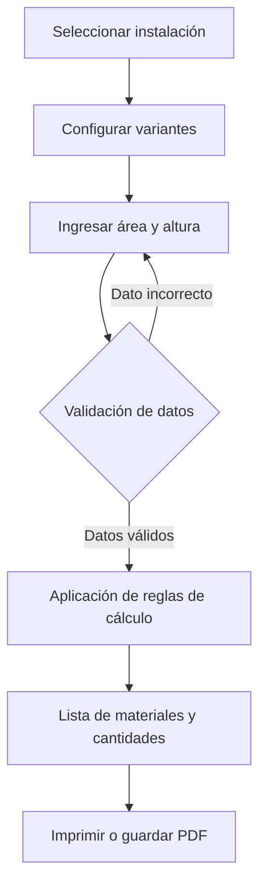

# Análisis funcional y técnico — Calculadora de Materiales SICON 2026

**Sitio analizado:** https://siconecuador.com/calculadora/material_fc.html  
**Fecha del análisis:** 25 de octubre de 2026  
**Alcance:** Análisis de la interfaz y del contenido de la página. No se verificó el código fuente de los cálculos, sus llamadas de red ni la exactitud de sus resultados.

## 1. Descripción general

La **Calculadora de Materiales SICON 2026** es una herramienta web que permite estimar los materiales necesarios para ejecutar distintos sistemas de instalación y revestimiento. El usuario selecciona el tipo de instalación, configura sus variantes e introduce medidas del proyecto. La interfaz está diseñada para producir un listado de insumos con **código, nombre del material y cantidad**.

Según el texto mostrado en la página, los cálculos se basan en las normas técnicas y estándares internos de SICON. Esta afirmación corresponde a la descripción del sitio y no implica que se hayan auditado los coeficientes utilizados.

## 2. Objetivo y usuarios

Su objetivo es facilitar la **cuantificación de materiales** en la planificación de obras, agilizar la preparación de listas de compra y reducir el esfuerzo de realizar cálculos manuales. Puede ser útil para instaladores, técnicos, vendedores, contratistas y clientes que necesitan estimar insumos.

**No debe confundirse con un presupuesto económico completo**: la interfaz inspeccionada presenta cantidades de materiales, pero no mostró precios unitarios ni totales monetarios.

## 3. Tipos de instalación disponibles

La página presenta diez categorías:

| Nº | Instalación | Finalidad |
|---:|---|---|
| 1 | Tumbado Gypsum Plano | Techos falsos con planchas de gypsum. |
| 2 | Cielo Raso Estructura Vista | Cielo raso modular con estructura visible. |
| 3 | Pared Doble Forramiento | Revestimiento de dos caras de una pared. |
| 4 | Pared Forramiento Una Cara | Revestimiento de una cara de una pared. |
| 5 | Pared Fibrocemento Interiores | Revestimientos interiores con fibrocemento. |
| 6 | Pegado de Plancha / Enchape | Colocación de planchas sobre una superficie. |
| 7 | Cielo Raso PVC | Instalación de cielos rasos de PVC. |
| 8 | WPC Interiores | Revestimiento decorativo para interiores. |
| 9 | WPC Exteriores | Revestimiento decorativo para exteriores. |
| 10 | Marmoleados PVC | Paneles decorativos de apariencia marmoleada. |

## 4. Datos y variantes que admite

Las opciones visibles en la página incluyen, dependiendo del tipo de instalación:

- **Planchas:** Regular 1/2", Exterior 1/2", Regular 5/8", Guard 1/2" (humedad), Guard 5/8" (humedad), Light 1/2", Fire C 1/2" y Fire X 5/8".
- **Grilla:** 2 × 2 y 2 × 4.
- **Separación de studs:** 0,610 m; 0,407 m; 0,305 m.
- **Tamaño y fijación:** 17 cm o 19,5 cm, con fijación mecánica o adhesiva.
- **Tipo de fijación:** mecánica o adhesiva.
- **Tamaño del panel:** 2,44 m o 2,90 m.
- **Datos del proyecto:** área a instalar, en metros cuadrados (m²), y altura de pared, en metros.

No todas estas opciones necesariamente se muestran para todos los sistemas: las variantes dependen de la instalación elegida.

## 5. Funcionamiento paso a paso

1. **Elegir el tipo de instalación.** El usuario selecciona uno de los diez sistemas disponibles.
2. **Seleccionar las variantes.** Configura, según corresponda, plancha, espesor, grilla, separación de studs, tipo de fijación o tamaño de panel.
3. **Introducir los datos del proyecto.** Ingresa el área y, cuando se requiera, la altura de pared.
4. **Solicitar el cálculo.** Presiona el botón **«⚡ Calcular Materiales»**.
5. **Revisar el resultado.** La interfaz dispone de un resumen de área y una tabla con columnas **Código**, **Material** y **Cantidad**.
6. **Imprimir o guardar.** Hay un botón **«🖨 Imprimir / Guardar PDF»**.

### Flujo conceptual



> **Nota:** El flujo de validación y las reglas de cálculo se presentan como modelo lógico esperado; no se comprobaron ejecutando la aplicación.

## 6. Análisis de la lógica de cálculo

Por su finalidad, una calculadora de este tipo suele trabajar con **rendimientos, factores de consumo, dimensiones comerciales y reglas de redondeo**. No se pudo determinar cuáles son las fórmulas exactas que usa SICON.

### Ejemplo meramente ilustrativo

Si una plancha hipotética cubre **2,88 m²** y el área del proyecto es **50 m²**, el número mínimo de planchas sin considerar pérdidas sería:

```text
Cantidad = redondear_hacia_arriba(Área / Cobertura_por_plancha)
Cantidad = redondear_hacia_arriba(50 / 2,88)
Cantidad = 18 planchas
```

En una estimación real también pueden influir desperdicios, cortes, separación de perfiles, estructura, fijaciones y características de la instalación. **Este ejemplo no reproduce ni valida un cálculo de SICON.**

## 7. Evaluación técnica de lo observable

| Componente | Estado |
|---|---|
| Interfaz web para elegir sistemas | Visible y confirmado |
| Opciones de variantes | Visibles y confirmadas |
| Campos numéricos de área y altura | Visibles y confirmados |
| Botón para calcular | Visible |
| Tabla de resultados | Estructura visible |
| Botón de impresión/PDF | Visible |
| Exactitud de las cantidades | No verificada |
| Validación real de entradas | No verificada |
| Fórmulas y coeficientes | No inspeccionados |
| Lenguaje de programación y framework | No determinados |
| API, servidor y base de datos | No determinados |
| Exportación a PDF en ejecución | No probada |

La presencia de controles interactivos no basta para afirmar qué tecnología se utilizó internamente. Para determinarlo se requeriría revisar el código y, cuando corresponda, las solicitudes de red del navegador.

## 8. Fortalezas y oportunidades de mejora

**Fortalezas observables:**

- Agrupa diez tipos de instalación en una misma herramienta.
- Organiza el uso en secciones de selección y datos del proyecto.
- Ofrece opciones técnicas relevantes para distintos sistemas constructivos.
- Prevé una salida tabular con códigos y cantidades de materiales.
- Incluye una opción para imprimir o guardar el resultado.

**Mejoras recomendadas (no son fallos confirmados):**

- Mostrar las **unidades** de cada cantidad: unidades, m, m², sacos, cajas, etc.
- Explicar qué **coeficientes, rendimiento y margen de desperdicio** se aplican.
- Validar valores vacíos, negativos, cero o fuera de rangos razonables.
- Mostrar mensajes claros cuando falte un dato requerido.
- Permitir descargar el listado como CSV o Excel.
- Incorporar precios unitarios para generar presupuestos opcionales.
- Guardar proyectos y recuperar cotizaciones anteriores.
- Añadir fecha, tipo de instalación y variantes al documento imprimible.

## 9. Arquitectura propuesta para desarrollar un sistema similar

Si se quisiera construir una calculadora comparable y ampliable, una arquitectura adecuada podría ser:

- **Frontend:** React + TypeScript para formularios, selección de variantes, tabla y vistas de impresión.
- **Backend:** Node.js + Express para validación y cálculo de materiales.
- **Base de datos:** PostgreSQL para catálogos, reglas, coeficientes, proyectos y versiones de las fórmulas.
- **Motor de cálculo:** módulo independiente de reglas por sistema de instalación.
- **Exportación:** PDF y opcionalmente CSV/Excel.

Esta es una **propuesta de implementación**, no una descripción de la arquitectura real del sitio.

### Entidades de datos sugeridas

```text
TipoInstalacion
  id, nombre, descripcion

VarianteInstalacion
  id, tipo_instalacion_id, nombre, valor

Material
  id, codigo, nombre, unidad, dimensiones

ReglaCalculo
  id, tipo_instalacion_id, material_id, expresion, coeficiente, version

Proyecto
  id, tipo_instalacion_id, area_m2, altura_m, fecha

ResultadoMaterial
  id, proyecto_id, material_id, cantidad
```

## 10. Pruebas recomendadas

Para verificar el comportamiento real, se debería probar al menos:

1. Un cálculo válido por cada uno de los diez sistemas.
2. Entradas vacías, cero, negativas y decimales.
3. Cambios en variantes manteniendo la misma área.
4. Redondeos y unidades de cada material.
5. Resultados para áreas pequeñas y grandes.
6. Dependencia de la altura en los sistemas de pared.
7. Actualización de resultados después de modificar parámetros.
8. Funcionamiento del botón de imprimir/guardar PDF.
9. Responsividad en móvil y escritorio.
10. Comparación de cantidades contra fichas técnicas y cálculos manuales autorizados.

## 11. Conclusión

La **Calculadora de Materiales SICON 2026** es una herramienta orientada a la **estimación de cantidades de materiales de construcción**, a partir de un tipo de instalación, sus variantes técnicas y las medidas del proyecto. Su principal utilidad es facilitar la planificación de insumos y la preparación de listas de materiales.

El análisis confirma la estructura funcional visible, pero **no permite garantizar la exactitud de las fórmulas ni identificar el stack tecnológico interno**. Para un análisis de ingeniería inversa más profundo, el siguiente paso sería inspeccionar los scripts, observar solicitudes de red y ejecutar cálculos de prueba contrastados con los estándares técnicos aplicables.

---

**Fuente principal:** [Calculadora de Materiales SICON 2026](https://siconecuador.com/calculadora/material_fc.html).  
**Elaboración:** análisis descriptivo de la página accesible el 25 de octubre de 2026.
